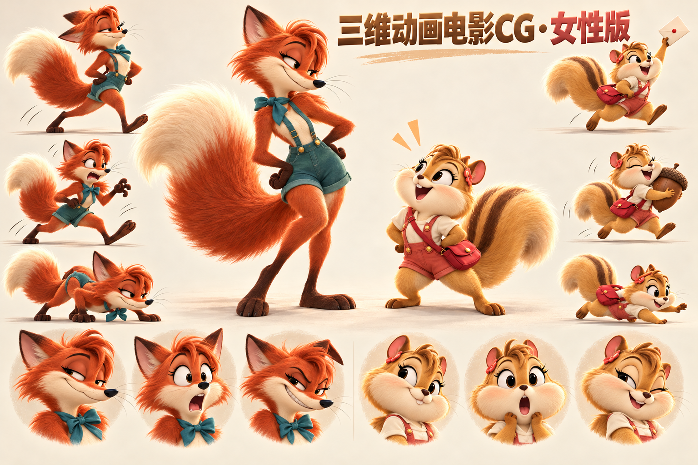

# 狐狸和松鼠

创建日期：2026-11-02。当前阶段：角色形象探索；尚未开始剧本、分镜或视频生产。

## 当前参考

会话最近完成的是电影 CG 女性版，作为当前工作参考，最终角色版本尚待选择。此前各画风均为探索稿，不代表已定稿。

## 已有角色方向

以下为会话已有设计的整理，名字和性格均为暂定方案。

- 阿栗：赤褐色狐狸，奶油色口鼻与腹部、大尾巴与奶油色尾尖、青色领结；高挑，爱耍帅，遇事容易慌。女性版采用侧分额前毛发、青色蝴蝶结与背带短裤。
- 豆丁：原设计具体为花栗鼠，金黄色毛发、深棕条纹、圆脸蓬尾、红色邮差斜挎包；机灵、贪吃、爱恶作剧。女性版增加红色发夹与背带裤。
- 可探索的关系：设局与反将一军的追逐喜剧搭档。尚未确定正式故事和角色关系。

## 参考图

所有已生成版本保存在 [输入/参考图](输入/参考图/)。包含复古美式、二次元、Q版、电影CG、潮玩、游戏CG、黏土、水彩、漫画，以及电影CG女性版，共10张。

## 待定事项

- 最终采用原版、女性版或重新设计；是否保留暂定名字。
- “呱呱历险记”参考尚缺用户确认的角色截图，未据此新增形象。
- 故事方向、集数、单集时长、最终画幅和目标视频模型。
- 配置中的9:16画幅与英文提示词语言为初始化工具默认值，尚未经用户确认。

## 继续创作

可直接提出“确定女性CG版，写第一集”或“先完善这两个角色”。后续按需在 `剧集/EP001/` 建立剧本、视觉设定、分镜、图片提示词和视频提示词，不预建空白创作文档。
