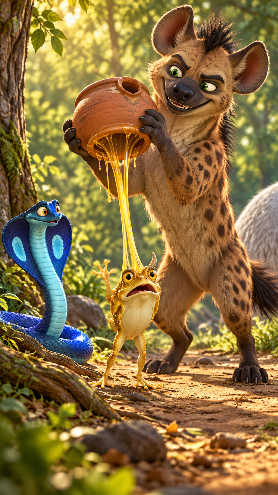
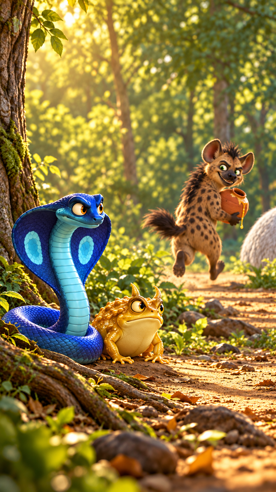
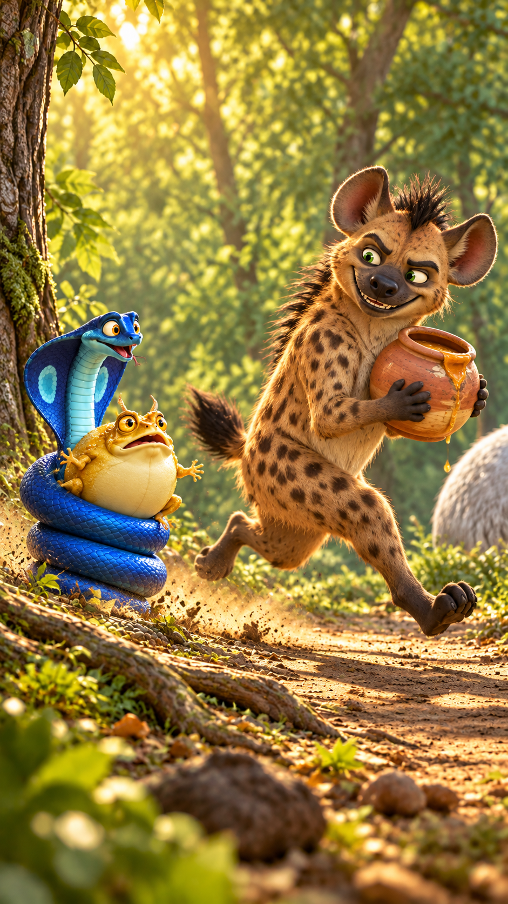
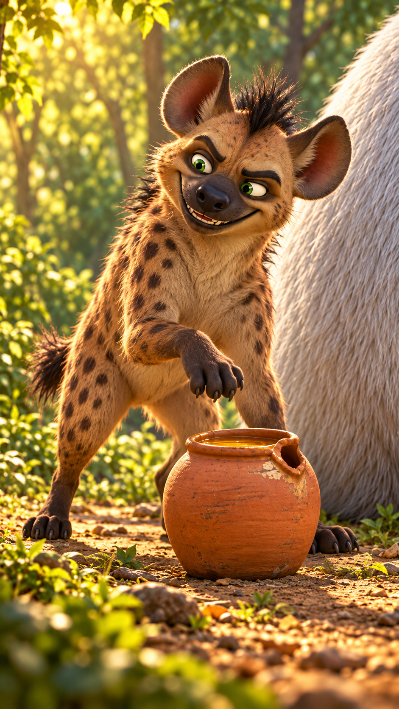
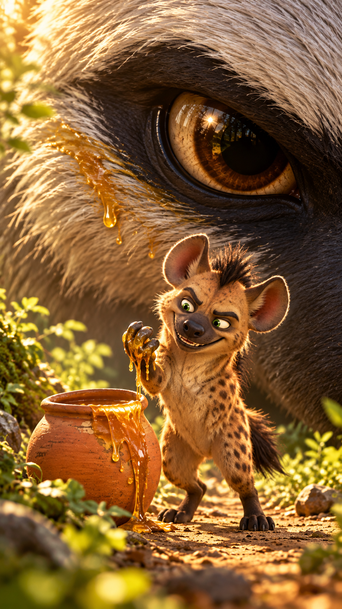
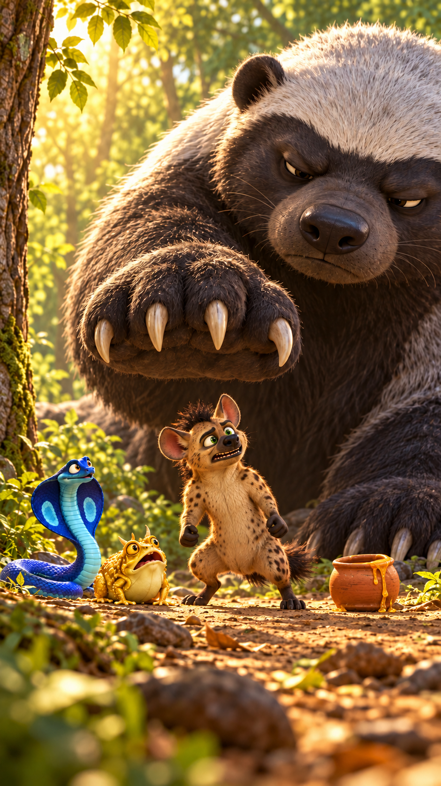

# 《偷蜂蜜？你抱走的是巨兽的早餐！》

- 时长：30秒，6镜，每镜5秒。
- 主题：绿眼鬣狗偷走蜂蜜，黄金角蛙与宝石蓝眼镜蛇合体追讨，最终惊醒早餐被偷的巨型蜜獾。
- 表现：3D动物肢体喜剧，无对白、无旁白，用动作和音效讲故事。
- 画幅：沿用项目当前9:16默认值。
- 状态：6张独立首帧已生成；D已改为MiniMax H3首帧图生视频提示词。

## 故事核心

鬣狗以为抢到的是两只小动物的蜂蜜，最后才发现自己偷了山一样大的蜜獾的早餐。角蛙的鼓胀弹跳与眼镜蛇的展颈盘绕组成一台活体弹射器；看似占尽便宜的鬣狗，最后被一根巨爪轻轻按成一张毛毯。

## 整体剧情

0—5秒：鬣狗抱走蜂蜜罐，罐底黏住黄金角蛙，把它拉成长长的金色软糖。宝石蓝眼镜蛇在树根边瞪圆眼睛。

5—10秒：角蛙脱离罐底、弹回原形，愤怒鼓成圆球；眼镜蛇把身体盘成螺旋底座，展开颈部形成两片蓝色护翼，角蛙落入盘绕中央，组成蛙蛇弹射器。

10—15秒：蛇身如弹簧释放，把圆球角蛙弹射出去；镜头绕至角蛙后上方，贴身跟飞，追向沿林间小径往画面深处逃跑的鬣狗。角蛙撞中它的屁股，鬣狗滑至灰白“山丘”脚下，蜜罐落地立稳。

15—20秒：鬣狗撞到“山丘”边缘，蜂蜜罐落在脚边；它舀起一爪蜂蜜，得意地涂上灰白表面。头顶草屑纷纷落下，一只巨眼从毛发间睁开。

20—25秒：镜头拉远，山丘竟是趴睡的巨型蜜獾。它抬起头，目光从蜂蜜罐移到鬣狗沾蜜的爪子。小小的鬣狗僵住。

25—30秒：巨爪按下，把鬣狗压成无伤的毛毯状。蜜獾抬爪，鬣狗仍趴在地上，只有两只绿眼睛眨动；角蛙落在左侧，眼镜蛇松开盘绕停在旁边，两者同时慢慢后退。

## 【氛围与画质】固定原文

以下英文段落为本方案拟定的固定原文，A—D每条可复制提示词逐字使用。

> Stylized cinematic 3D animal comedy, playful tension, clear exaggerated expressions, saturated gold and sapphire blue against warm green foliage, warm afternoon sunlight, soft shadows, physically based materials, readable silhouettes, consistent character proportions, crisp focal subjects, vertical 9:16 composition, no captions, no logos, no watermarks, no gore.

## A | 人物角色提示词

### A1 黄金角蛙

> Character design sheet of one golden horned frog, squat round body, lemon-gold skin, two raised hornlike ridges above amber eyes, cream belly, short limbs, oversized expressive mouth. Three clearly separated views on a neutral background: front, side, three-quarter. Same individual and proportions in all views. No accessories. Stylized cinematic 3D animal comedy, playful tension, clear exaggerated expressions, saturated gold and sapphire blue against warm green foliage, warm afternoon sunlight, soft shadows, physically based materials, readable silhouettes, consistent character proportions, crisp focal subjects, vertical 9:16 composition, no captions, no logos, no watermarks, no gore.

### A2 宝石蓝眼镜蛇

> Character design sheet of one sapphire-blue cobra, glossy blue scales, pale cyan belly, amber eyes, two pale cyan oval markings on the front of its expanded hood. Three separated views: front with hood expanded, side with hood relaxed, three-quarter coiled pose. One continuous body, one head, one tail, no limbs. Stylized cinematic 3D animal comedy, playful tension, clear exaggerated expressions, saturated gold and sapphire blue against warm green foliage, warm afternoon sunlight, soft shadows, physically based materials, readable silhouettes, consistent character proportions, crisp focal subjects, vertical 9:16 composition, no captions, no logos, no watermarks, no gore.

### A3 绿眼鬣狗

> Character design sheet of one spotted hyena, sandy brown fur, dark muzzle, ragged short dark mane, bright green eyes, oversized rounded ears, lanky hindquarters, smug crooked grin. Three separated views: front, side, three-quarter. No clothing or accessories. Stylized cinematic 3D animal comedy, playful tension, clear exaggerated expressions, saturated gold and sapphire blue against warm green foliage, warm afternoon sunlight, soft shadows, physically based materials, readable silhouettes, consistent character proportions, crisp focal subjects, vertical 9:16 composition, no captions, no logos, no watermarks, no gore.

### A4 巨型蜜獾

> Character design sheet of one colossal honey badger, charcoal-black face and underside, broad silver-white fur mantle running from crown to back, blunt muzzle, sleepy dark eyes, massive rounded forepaws with short ivory claws. Three separated views: front, side, resting three-quarter. A tiny unmarked terracotta honey pot beside one paw establishes that the animal is twenty times taller than the hyena. Stylized cinematic 3D animal comedy, playful tension, clear exaggerated expressions, saturated gold and sapphire blue against warm green foliage, warm afternoon sunlight, soft shadows, physically based materials, readable silhouettes, consistent character proportions, crisp focal subjects, vertical 9:16 composition, no captions, no logos, no watermarks, no gore.

### A5 蛙蛇合体状态

> One golden horned frog inflated into a round ball, its amber eyes and hornlike brow ridges still recognizable, seated inside a spring-shaped coil made by one sapphire-blue cobra. The cobra's single head faces forward; its expanded blue hood frames the frog like two curved shields. A living catapult, two recognizable animals touching physically, distinct gold skin and blue scales, no machinery, no extra heads or limbs. Neutral background, three-quarter view, entire assembly visible. Stylized cinematic 3D animal comedy, playful tension, clear exaggerated expressions, saturated gold and sapphire blue against warm green foliage, warm afternoon sunlight, soft shadows, physically based materials, readable silhouettes, consistent character proportions, crisp focal subjects, vertical 9:16 composition, no captions, no logos, no watermarks, no gore.

## B | 场景图片提示词

### B1 林间蜂蜜空地

> Empty woodland clearing, exposed tree roots on the left, a narrow dirt slide leading from left foreground toward right background, a rounded silver-white furry mound at the far right edge, its face completely outside the composition. Warm green foliage, warm afternoon sunlight from upper left. One squat unmarked terracotta pot with a single chipped rim sits by the roots, filled with amber honey. Ground-level wide establishing view, clear open action corridor, no animals visible. Stylized cinematic 3D animal comedy, playful tension, clear exaggerated expressions, saturated gold and sapphire blue against warm green foliage, warm afternoon sunlight, soft shadows, physically based materials, readable silhouettes, consistent character proportions, crisp focal subjects, vertical 9:16 composition, no captions, no logos, no watermarks, no gore.

## C | 分镜参考图提示词（6宫格）

选择6宫格：本片有六个不同的戏剧节点，每格对应一个5秒镜头。排版为2列×3行，阅读顺序从左到右、从上到下。宫格用于整体构图预览；本次使用已生成的6张独立首帧，不直接上传整张宫格。

> A six-panel storyboard contact sheet arranged in two columns and three rows, six equal vertical panels, narrow clean gutters, no numbers or lettering. Same woodland clearing and characters throughout. Panel 1: a green-eyed spotted hyena at center-right holds an unmarked terracotta honey pot with one chipped rim; a golden horned frog clings to the sticky underside, already stretched vertically like soft candy, and a sapphire-blue cobra watches from the left roots. Panel 2: at the left roots, the frog has regained its normal round shape on the ground beside the cobra, while the fleeing hyena and honey pot appear small at right. Panel 3: the golden frog is inflated into a ball inside the cobra's compressed spring-shaped coil, the blue hood expanded behind it; the hyena carries the pot toward a path receding into the deep right background. Panel 4: the hyena has reached the base of a vast silver-white furry mound, the upright honey pot at its feet, one empty forepaw hovering above the honey pot; only the mound's flank is visible. Panel 5: a giant dark eye is open above the tiny hyena, with honey smeared on the silver-white fur below the eye, the pot still upright at the hyena's feet. Panel 6: wide view of the fully revealed colossal honey badger, its enormous forepaw raised over the tiny hyena beside the pot; the golden frog and blue cobra are visible far left. Each panel shows a single frozen starting state, no motion arrows, no repeated figures within a panel. Stylized cinematic 3D animal comedy, playful tension, clear exaggerated expressions, saturated gold and sapphire blue against warm green foliage, warm afternoon sunlight, soft shadows, physically based materials, readable silhouettes, consistent character proportions, crisp focal subjects, vertical 9:16 composition, no captions, no logos, no watermarks, no gore.

## D | AI视频提示词 · MiniMax H3 首帧模式

使用方式：每镜上传下列唯一首帧，选择 MiniMax-H3 的首帧图生视频模式，时长设置为5秒。将该镜三个英文字段的完整引用块一起复制进提示词框；按001—006顺序剪接成30秒。每镜都是更换机位后的独立首帧生成，不使用上一段视频续接。

本次只生成参考图片并编写视频提示词，尚未调用H3生成视频。图片使用内置imagegen生成。

| 镜头 | 时间 | 首帧 |
|---|---|---|
| SHOT-001 | 0—5秒 | [SHOT-001-start.png](../剧集/EP001/制作成果/images/SHOT-001-start.png) |
| SHOT-002 | 5—10秒 | [SHOT-002-start.png](../剧集/EP001/制作成果/images/SHOT-002-start.png) |
| SHOT-003 | 10—15秒 | [SHOT-003-start.png](../剧集/EP001/制作成果/images/SHOT-003-start.png) |
| SHOT-004 | 15—20秒 | [SHOT-004-start.png](../剧集/EP001/制作成果/images/SHOT-004-start.png) |
| SHOT-005 | 20—25秒 | [SHOT-005-start.png](../剧集/EP001/制作成果/images/SHOT-005-start.png) |
| SHOT-006 | 25—30秒 | [SHOT-006-start.png](../剧集/EP001/制作成果/images/SHOT-006-start.png) |

### MOTION-001 · 偷蜜钩子

- 分镜：SHOT-001，对应C模块第1格。实际起始构图以本镜已生成首帧为准。
- 时长：5秒
- 生成方式：图生视频
- H3模式：first_frame；本镜仅上传这一张图，不另挂角色板或场景板。
- 输入参考图：REF-SHOT001-START（顺序：1）· 剧集/EP001/制作成果/images/SHOT-001-start.png《SHOT-001 起始帧》（用途：起始帧；控制：起始构图、可见角色身份、站位、道具状态、光线；不得控制：后续动作、终态）
- 静态视觉锚点：A woodland clearing, exposed roots on the left, a dirt corridor running left to right toward a silver-white furry mound at right, warm afternoon sunlight from upper left. Fixed medium shot. Visible characters: a sandy-brown spotted hyena with bright green eyes, a dark muzzle, a short ragged dark mane and oversized rounded ears; a lemon-gold horned frog with amber eyes, two raised hornlike brow ridges, a cream belly and short limbs; a sapphire-blue cobra with glossy scales, a pale cyan belly, amber eyes and two pale cyan oval markings on its expanded hood, one head and one continuous limbless body. The hyena is center-right, the frog below its pot, and the cobra watches from the left roots. The mound is only an indistinct edge; no giant eye or face is visible.
- 起始帧：The hyena holds a tilted terracotta pot above the golden frog; long honey strands stretch from the pot to the frog, whose eyes and hornlike brows are visible. The blue cobra watches from the left roots.
- 状态链：0–2 seconds: the hyena pulls the tilted pot upward, drawing the sticky honey and elastic frog farther upward. 2–3 seconds: the honey strand snaps; the frog recoils left onto the roots and regains its squat shape. 3–5 seconds: the hyena rights the SAME pot so its opening faces up, hugs it and runs right. The cobra stays beside the recovered frog. Fixed camera throughout.
- 终点：The round frog and cobra remain at the left roots; the hyena is fleeing right with the pot.

#### 可复制提示词

> integrated_multimodal_description: [Shot 1] A single continuous five-second shot. Begin exactly from the supplied first frame; preserve the visible character identities, materials, honey pot, lighting and initial composition. The hyena holds a tilted terracotta pot above the golden frog; long honey strands stretch from the pot to the frog, whose eyes and hornlike brows are visible. The blue cobra watches from the left roots. 0–2 seconds: the hyena pulls the tilted pot upward, drawing the sticky honey and elastic frog farther upward. 2–3 seconds: the honey strand snaps; the frog recoils left onto the roots and regains its squat shape. 3–5 seconds: the hyena rights the SAME pot so its opening faces up, hugs it and runs right. The cobra stays beside the recovered frog. Fixed camera throughout. End frame: The round frog and cobra remain at the left roots; the hyena is fleeing right with the pot. At no time generate subtitles, captions or dialogue text overlays. Stylized cinematic 3D animal comedy, playful tension, clear exaggerated expressions, saturated gold and sapphire blue against warm green foliage, warm afternoon sunlight, soft shadows, physically based materials, readable silhouettes, consistent character proportions, crisp focal subjects, vertical 9:16 composition, no captions, no logos, no watermarks, no gore.
>
> overall_soundscape: quiet woodland ambience throughout; synchronize these effects with the visible actions: Sticky stretching, a rubbery snap, then hurried paw steps. No dialogue, narration, human voices or background music. At no time generate subtitles, captions or dialogue text overlays.
>
> non_diegetic_music: N/A

### MOTION-002 · 蛙蛇合体

- 分镜：SHOT-002，对应C模块第2格。实际起始构图以本镜已生成首帧为准。
- 时长：5秒
- 生成方式：图生视频
- H3模式：first_frame；本镜仅上传这一张图，不另挂角色板或场景板。
- 输入参考图：REF-SHOT002-START（顺序：1）· 剧集/EP001/制作成果/images/SHOT-002-start.png《SHOT-002 起始帧》（用途：起始帧；控制：起始构图、可见角色身份、站位、道具状态、光线；不得控制：后续动作、终态）
- 静态视觉锚点：A woodland clearing, exposed roots on the left, a dirt corridor running left to right toward a silver-white furry mound at right, warm afternoon sunlight from upper left. Low medium-close shot at the left roots: a lemon-gold horned frog with amber eyes, two raised hornlike brow ridges, a cream belly and short limbs beside a sapphire-blue cobra with glossy scales, a pale cyan belly, amber eyes and two pale cyan oval markings on its expanded hood, one head and one continuous limbless body. At the far right, a sandy-brown spotted hyena with bright green eyes, a dark muzzle, a short ragged dark mane and oversized rounded ears carries one squat unmarked terracotta honey pot with a single chipped rim, filled with amber honey away.
- 起始帧：The frog has its ordinary squat body and sits beside the uncoiled cobra.
- 状态链：0–2 seconds: the frog inhales and inflates into a gold ball, keeping its eyes and hornlike brows. 2–4 seconds: the cobra winds its body into a three-loop spring beneath the frog as the frog makes a small hop into the center. 4–5 seconds: the cobra expands its hood into two curved blue shields and compresses the spring. Gently push toward the assembly. The two animals remain separately recognizable and physically touching, with no machinery or additional limbs.
- 终点：A gold ball-shaped frog sits inside the compressed blue cobra spring, aimed right.

#### 可复制提示词

> integrated_multimodal_description: [Shot 1] A single continuous five-second shot. Begin exactly from the supplied first frame; preserve the visible character identities, materials, honey pot, lighting and initial composition. The frog has its ordinary squat body and sits beside the uncoiled cobra. 0–2 seconds: the frog inhales and inflates into a gold ball, keeping its eyes and hornlike brows. 2–4 seconds: the cobra winds its body into a three-loop spring beneath the frog as the frog makes a small hop into the center. 4–5 seconds: the cobra expands its hood into two curved blue shields and compresses the spring. Gently push toward the assembly. The two animals remain separately recognizable and physically touching, with no machinery or additional limbs. End frame: A gold ball-shaped frog sits inside the compressed blue cobra spring, aimed right. At no time generate subtitles, captions or dialogue text overlays. Stylized cinematic 3D animal comedy, playful tension, clear exaggerated expressions, saturated gold and sapphire blue against warm green foliage, warm afternoon sunlight, soft shadows, physically based materials, readable silhouettes, consistent character proportions, crisp focal subjects, vertical 9:16 composition, no captions, no logos, no watermarks, no gore.
>
> overall_soundscape: quiet woodland ambience throughout; synchronize these effects with the visible actions: An exaggerated inhalation, sliding scales and a rising spring-creak sound. No dialogue, narration, human voices or background music. At no time generate subtitles, captions or dialogue text overlays.
>
> non_diegetic_music: N/A

### MOTION-003 · 弹射追击

- 分镜：SHOT-003，对应C模块第3格。实际起始构图以本镜已生成首帧为准。
- 运镜：起始侧面构图 → 随弹射平滑绕至角蛙后上方 → 贴身跟飞进入纵深；角蛙占近景、鬣狗在前方远处，距离持续缩短；撞击时减速，全镜不断切。
- 时长：5秒
- 生成方式：图生视频
- H3模式：first_frame；本镜仅上传这一张图，不另挂角色板或场景板。
- 输入参考图：REF-SHOT003-START（顺序：1）· 剧集/EP001/制作成果/images/SHOT-003-start.png《SHOT-003 起始帧》（用途：起始帧；控制：起始构图、可见角色身份、站位、道具状态、光线；不得控制：后续动作、终态）
- 静态视觉锚点：A woodland clearing, exposed roots on the left, a dirt corridor running left to right toward a silver-white furry mound at right, warm afternoon sunlight from upper left. Opening side-on wide shot; after launch the camera moves behind the frog for a forward depth-tracking chase. At left, a lemon-gold horned frog with amber eyes, two raised hornlike brow ridges, a cream belly and short limbs, inflated into a round ball, sits inside a compressed three-loop spring made by a sapphire-blue cobra with glossy scales, a pale cyan belly, amber eyes and two pale cyan oval markings on its expanded hood, one head and one continuous limbless body. At center-right, a sandy-brown spotted hyena with bright green eyes, a dark muzzle, a short ragged dark mane and oversized rounded ears runs right holding one squat unmarked terracotta honey pot with a single chipped rim, filled with amber honey. The silver-white mound shows no recognizable face.
- 起始帧：The frog-and-cobra catapult is loaded on the left; the hyena is ahead to the right, about to follow the path away into the forest depth.
- 状态链：0–0.8 seconds: the cobra releases its compressed spring-shaped body and catapults the golden ball-shaped frog forward. As the frog launches, the camera accelerates with it and smoothly swings from the opening side view into a close trailing three-quarter view just behind and slightly above the airborne frog. 0.8–3 seconds: fly with the frog along the dirt path INTO THE DEPTH OF THE FOREST, keeping the frog in the near foreground and the fleeing green-eyed hyena ahead in the center background. The hyena runs away from the camera toward the distant silver-white mound, clutching the honey pot. Strong ground parallax and foliage streaking past convey forward speed; continuously close the distance without cutting or overtaking the frog. 3–5 seconds: the frog strikes the hyena on the rump; the hyena skids forward to the mound and drops the same pot upright at its feet. Brake the camera smoothly at impact, retaining the frog as it rebounds toward the left side of the path, deflates and lands safely. The cobra stays behind at the launch point, now out of frame.
- 终点：The hyena has stopped at the mound with the intact pot upright at its feet; the normal-shaped frog has landed at the left side of the path. The cobra remains behind at the original roots, outside the frame.

#### 可复制提示词

> integrated_multimodal_description: [Shot 1] A single continuous five-second shot. Begin exactly from the supplied first frame; preserve the visible character identities, materials, honey pot, lighting and initial composition. The frog-and-cobra catapult is loaded on the left; the hyena is ahead to the right, about to follow the path away into the forest depth. 0–0.8 seconds: the cobra releases its compressed spring-shaped body and catapults the golden ball-shaped frog forward. As the frog launches, the camera accelerates with it and smoothly swings from the opening side view into a close trailing three-quarter view just behind and slightly above the airborne frog. 0.8–3 seconds: fly with the frog along the dirt path INTO THE DEPTH OF THE FOREST, keeping the frog in the near foreground and the fleeing green-eyed hyena ahead in the center background. The hyena runs away from the camera toward the distant silver-white mound, clutching the honey pot. Strong ground parallax and foliage streaking past convey forward speed; continuously close the distance without cutting or overtaking the frog. 3–5 seconds: the frog strikes the hyena on the rump; the hyena skids forward to the mound and drops the same pot upright at its feet. Brake the camera smoothly at impact, retaining the frog as it rebounds toward the left side of the path, deflates and lands safely. The cobra stays behind at the launch point, now out of frame. End frame: The hyena has stopped at the mound with the intact pot upright at its feet; the normal-shaped frog has landed at the left side of the path. The cobra remains behind at the original roots, outside the frame. At no time generate subtitles, captions or dialogue text overlays. Stylized cinematic 3D animal comedy, playful tension, clear exaggerated expressions, saturated gold and sapphire blue against warm green foliage, warm afternoon sunlight, soft shadows, physically based materials, readable silhouettes, consistent character proportions, crisp focal subjects, vertical 9:16 composition, no captions, no logos, no watermarks, no gore.
>
> overall_soundscape: quiet woodland ambience throughout; synchronize these effects with the visible actions: A spring twang at launch, rushing air building through the flight, then a soft rump impact, scraping dirt and a small clay-pot thud. No dialogue, narration, human voices or background music. At no time generate subtitles, captions or dialogue text overlays.
>
> non_diegetic_music: N/A

### MOTION-004 · 抹蜜作死

- 分镜：SHOT-004，对应C模块第4格。实际起始构图以本镜已生成首帧为准。
- 时长：5秒
- 生成方式：图生视频
- H3模式：first_frame；本镜仅上传这一张图，不另挂角色板或场景板。
- 输入参考图：REF-SHOT004-START（顺序：1）· 剧集/EP001/制作成果/images/SHOT-004-start.png《SHOT-004 起始帧》（用途：起始帧；控制：起始构图、可见角色身份、站位、道具状态、光线；不得控制：后续动作、终态）
- 静态视觉锚点：A woodland clearing, exposed roots on the left, a dirt corridor running left to right toward a silver-white furry mound at right, warm afternoon sunlight from upper left. Fixed medium shot at the right mound. a sandy-brown spotted hyena with bright green eyes, a dark muzzle, a short ragged dark mane and oversized rounded ears stands beside one squat unmarked terracotta honey pot with a single chipped rim, filled with amber honey. Silver-white fur fills the background; the giant animal remains otherwise outside the frame.
- 起始帧：The pot is upright at the hyena’s feet; one empty forepaw hovers just above the honey.
- 状态链：0–2 seconds: the hyena dips that forepaw into the pot, scoops a little honey and wipes it onto the silver-white fur. 2–3 seconds: it sticks out its tongue in a smug grin. 3–5 seconds: the fur trembles, grass fragments tumble from above and one enormous dark eye opens above the small hyena. Keep the rest of the giant face outside the frame.
- 终点：The giant eye is open above the oblivious hyena, the honey smear remains on the fur and the pot stays at its feet.

#### 可复制提示词

> integrated_multimodal_description: [Shot 1] A single continuous five-second shot. Begin exactly from the supplied first frame; preserve the visible character identities, materials, honey pot, lighting and initial composition. The pot is upright at the hyena’s feet; one empty forepaw hovers just above the honey. 0–2 seconds: the hyena dips that forepaw into the pot, scoops a little honey and wipes it onto the silver-white fur. 2–3 seconds: it sticks out its tongue in a smug grin. 3–5 seconds: the fur trembles, grass fragments tumble from above and one enormous dark eye opens above the small hyena. Keep the rest of the giant face outside the frame. End frame: The giant eye is open above the oblivious hyena, the honey smear remains on the fur and the pot stays at its feet. At no time generate subtitles, captions or dialogue text overlays. Stylized cinematic 3D animal comedy, playful tension, clear exaggerated expressions, saturated gold and sapphire blue against warm green foliage, warm afternoon sunlight, soft shadows, physically based materials, readable silhouettes, consistent character proportions, crisp focal subjects, vertical 9:16 composition, no captions, no logos, no watermarks, no gore.
>
> overall_soundscape: quiet woodland ambience throughout; synchronize these effects with the visible actions: Wet honey sounds, rustling fur and one deep breath from the giant. No dialogue, narration, human voices or background music. At no time generate subtitles, captions or dialogue text overlays.
>
> non_diegetic_music: N/A

### MOTION-005 · 巨兽揭晓

- 分镜：SHOT-005，对应C模块第5格。实际起始构图以本镜已生成首帧为准。
- 时长：5秒
- 生成方式：图生视频
- H3模式：first_frame；本镜仅上传这一张图，不另挂角色板或场景板。
- 输入参考图：REF-SHOT005-START（顺序：1）· 剧集/EP001/制作成果/images/SHOT-005-start.png《SHOT-005 起始帧》（用途：起始帧；控制：起始构图、可见角色身份、站位、道具状态、光线；不得控制：后续动作、终态）
- 静态视觉锚点：A woodland clearing, exposed roots on the left, a dirt corridor running left to right toward a silver-white furry mound at right, warm afternoon sunlight from upper left. Begin on one open enormous dark eye above a sandy-brown spotted hyena with bright green eyes, a dark muzzle, a short ragged dark mane and oversized rounded ears, which stands beside one squat unmarked terracotta honey pot with a single chipped rim, filled with amber honey, one forepaw coated in honey. The owner of the eye is a colossal honey badger twenty times taller than the hyena, with a charcoal-black face and underside, a broad silver-white fur mantle from crown to back, dark eyes and enormous rounded forepaws with short ivory claws. Far left on the ground are a lemon-gold horned frog with amber eyes, two raised hornlike brow ridges, a cream belly and short limbs in normal shape and a sapphire-blue cobra with glossy scales, a pale cyan belly, amber eyes and two pale cyan oval markings on its expanded hood, one head and one continuous limbless body.
- 起始帧：Tight framing shows the eye, the honey smear below it and the tiny hyena; the giant’s whole body is not yet visible.
- 状态链：0–3 seconds: pull back smoothly to a wide view revealing the full resting honey badger. It lifts only its head, looks from the pot to the hyena’s honey-covered forepaw, and the hyena tilts its head upward and freezes. 3–5 seconds: the badger slowly raises one forepaw above the hyena. Far left, the cobra relaxes its spring coil beside the frog.
- 终点：The colossal badger is fully visible, one paw poised over the rigid hyena, with the pot beside the hyena and the frog and cobra far left.

#### 可复制提示词

> integrated_multimodal_description: [Shot 1] A single continuous five-second shot. Begin exactly from the supplied first frame; preserve the visible character identities, materials, honey pot, lighting and initial composition. Tight framing shows the eye, the honey smear below it and the tiny hyena; the giant’s whole body is not yet visible. 0–3 seconds: pull back smoothly to a wide view revealing the full resting honey badger. It lifts only its head, looks from the pot to the hyena’s honey-covered forepaw, and the hyena tilts its head upward and freezes. 3–5 seconds: the badger slowly raises one forepaw above the hyena. Far left, the cobra relaxes its spring coil beside the frog. End frame: The colossal badger is fully visible, one paw poised over the rigid hyena, with the pot beside the hyena and the frog and cobra far left. At no time generate subtitles, captions or dialogue text overlays. Stylized cinematic 3D animal comedy, playful tension, clear exaggerated expressions, saturated gold and sapphire blue against warm green foliage, warm afternoon sunlight, soft shadows, physically based materials, readable silhouettes, consistent character proportions, crisp focal subjects, vertical 9:16 composition, no captions, no logos, no watermarks, no gore.
>
> overall_soundscape: quiet woodland ambience throughout; synchronize these effects with the visible actions: A low ground rumble, a deep breath and tiny chattering teeth. No dialogue, narration, human voices or background music. At no time generate subtitles, captions or dialogue text overlays.
>
> non_diegetic_music: N/A

### MOTION-006 · 一爪收尾

- 分镜：SHOT-006，对应C模块第6格。实际起始构图以本镜已生成首帧为准。
- 时长：5秒
- 生成方式：图生视频
- H3模式：first_frame；本镜仅上传这一张图，不另挂角色板或场景板。
- 输入参考图：REF-SHOT006-START（顺序：1）· 剧集/EP001/制作成果/images/SHOT-006-start.png《SHOT-006 起始帧》（用途：起始帧；控制：起始构图、可见角色身份、站位、道具状态、光线；不得控制：后续动作、终态）
- 静态视觉锚点：A woodland clearing, exposed roots on the left, a dirt corridor running left to right toward a silver-white furry mound at right, warm afternoon sunlight from upper left. Fixed wide shot with all four animals visible: a colossal honey badger twenty times taller than the hyena, with a charcoal-black face and underside, a broad silver-white fur mantle from crown to back, dark eyes and enormous rounded forepaws with short ivory claws; a sandy-brown spotted hyena with bright green eyes, a dark muzzle, a short ragged dark mane and oversized rounded ears; a lemon-gold horned frog with amber eyes, two raised hornlike brow ridges, a cream belly and short limbs; a sapphire-blue cobra with glossy scales, a pale cyan belly, amber eyes and two pale cyan oval markings on its expanded hood, one head and one continuous limbless body. The badger dominates the right, its raised forepaw above the tiny hyena; one squat unmarked terracotta honey pot with a single chipped rim, filled with amber honey stands beside the hyena outside the paw’s footprint. The normal-shaped frog and loosely coiled cobra are far left.
- 起始帧：The giant forepaw is raised, the hyena is rigid beneath it, and the pot is safe beside it.
- 状态链：0–2 seconds: the giant paw gently presses the hyena flat against the dirt with a small puff of dust, missing the pot. 2–3 seconds: lift the paw to reveal the unharmed hyena flattened like a furry rug, its body still intact. 3–4 seconds: its two bright green eyes blink twice. 4–5 seconds: the frog and cobra slowly retreat left together while staring at the badger. Hold the comic tableau.
- 终点：The flattened hyena lies blinking beside the intact honey pot; the giant paw is lifted and the frog and cobra have backed away left.

#### 可复制提示词

> integrated_multimodal_description: [Shot 1] A single continuous five-second shot. Begin exactly from the supplied first frame; preserve the visible character identities, materials, honey pot, lighting and initial composition. The giant forepaw is raised, the hyena is rigid beneath it, and the pot is safe beside it. 0–2 seconds: the giant paw gently presses the hyena flat against the dirt with a small puff of dust, missing the pot. 2–3 seconds: lift the paw to reveal the unharmed hyena flattened like a furry rug, its body still intact. 3–4 seconds: its two bright green eyes blink twice. 4–5 seconds: the frog and cobra slowly retreat left together while staring at the badger. Hold the comic tableau. End frame: The flattened hyena lies blinking beside the intact honey pot; the giant paw is lifted and the frog and cobra have backed away left. At no time generate subtitles, captions or dialogue text overlays. Stylized cinematic 3D animal comedy, playful tension, clear exaggerated expressions, saturated gold and sapphire blue against warm green foliage, warm afternoon sunlight, soft shadows, physically based materials, readable silhouettes, consistent character proportions, crisp focal subjects, vertical 9:16 composition, no captions, no logos, no watermarks, no gore.
>
> overall_soundscape: quiet woodland ambience throughout; synchronize these effects with the visible actions: A soft bass thump, a brief comic squeeze sound, two tiny blink pops and quiet retreating scrapes. No dialogue, narration, human voices or background music. At no time generate subtitles, captions or dialogue text overlays.
>
> non_diegetic_music: N/A

## 十六、输出前自检

- 时长：30秒已由创作者确认；主题为本轮创作方案。
- 前5秒钩子：首秒可见角蛙被蜂蜜拉成长条。
- 专属变形：角蛙鼓胀成球；眼镜蛇盘绕成弹簧、展颈成护翼；两者实体组合。
- 巨兽收尾：巨型蜜獾一爪压平鬣狗，保留无伤喜剧表现。
- 宫格匹配：六个节点，采用6宫格，各格是对应镜头起点。
- 固定原文：A—D共十三条可复制提示词逐字附带同一段。
- 模块职责：A固定身份与合体状态，B固定空间，C固定起始构图，D固定运动与声音；必要的连续性锚点跨模块复用，叙事功能不重复。
- 输入方式：创作者已改选先生成图片，再使用MiniMax H3；6张首帧已绑定。文本与文件引用检查完成，视频动作及跨段连续性需在实际生成后复核。

## 十七、核心创作原则

核心公式：「黄金角蛙与宝石蓝眼镜蛇脑洞合体 + 绿眼鬣狗花式作死 + 巨型霸主降维打击 = 零语言门槛的全球化3D爆笑爽片」。

H3写法依据：[官方提示词指南](https://github.com/MiniMax-AI/MiniMax-H3/blob/main/skills/h3-prompt-writing/references/base-en.txt)、[官方生成接口](https://platform.minimax.io/docs/api-reference/video-generation-v2-create)。
